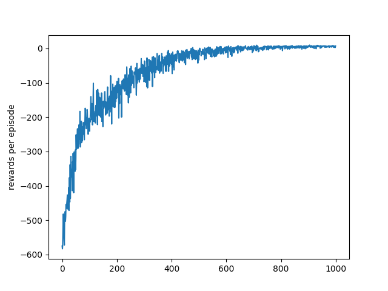
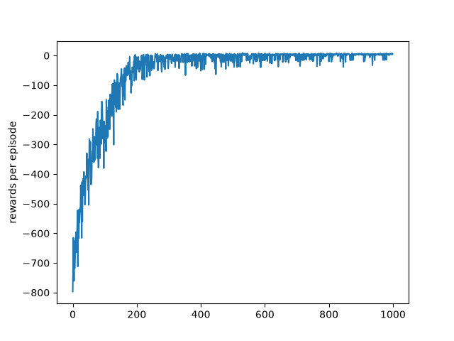

# Reinforcement Learning Project - Taxi-v4 with SARSA and SARSA(λ)

**Bachelor's Degree in Digital Technologies and Artificial Intelligence - 2025/2026**

Authors: Ilie Iftime (112779), Ines Cruz (123557), Sofia Quintino (123554)

Course: Autonomous Agents  
Lecturer: Ricardo Miranda

## Overview

This project implements and compares two Reinforcement Learning algorithms – **SARSA** and **SARSA(λ)** – on the classic **Taxi-v4** environment from Gymnasium. Both algorithms use tabular Q-learning with eligibility traces (for SARSA(λ)) and are implemented from scratch.

The goal is to learn an optimal policy that picks up and drops off a passenger at the correct destination while minimizing the number of steps and maximizing the total reward. The project includes training scripts, saved policies, Q-tables, learning curves, and a unit test suite for validation.

## Repository Structure

```text
RL_project_Autonomous_Agents/
├── __pycache__/
├── .vscode/
├── assets/
│   ├── gui_image.png
│   ├── rewards_plot_lambda.png          # Learning curve for SARSA(λ)
│   └── rewards_plot_taxi_sarsa.png      # Learning curve for SARSA
├── ignore_me.py
├── policy_taxi_sarsa_avaliacao.npy      # Saved policy for SARSA
├── policy_taxi_sarsa_lambda_avaliacao.npy  # Saved policy for SARSA(λ)
├── qvalues_taxi_sarsa_avaliacao.npy     # Saved Q-table for SARSA
├── qvalues_taxi_sarsa_lambda_avaliacao.npy  # Saved Q-table for SARSA(λ)
├── README.md
├── requirements.txt
├── tabular_sarsa.py                     # Base class for tabular SARSA
├── taxi_sarsa.py                        # SARSA implementation for Taxi-v4
├── taxi_sarsa_lambda.py                 # SARSA(λ) implementation for Taxi-v4
└── unit_test.py                         # Unit tests for validation
```

## Prerequisites

- Python 3.9+
- pip
- Virtual environment tool (venv, included in Python standard library)

## Setting Up the Environment

It is strongly recommended to use a virtual environment to avoid dependency conflicts.

### 1. Create a virtual environment

**On Windows:**
```bash
python -m venv venv
venv\Scripts\activate
```

**On macOS / Linux:**
```bash
python3 -m venv venv
source venv/bin/activate
```

### 2. Install dependencies

With the virtual environment activated, install the required packages:

```bash
pip install -r requirements.txt
```

The `requirements.txt` file contains the following dependencies:

```text
gymnasium>=0.29
numpy>=1.24
matplotlib>=3.7
pandas>=2.0
scipy>=1.10
plotly>=5.18
ipywidgets>=8.0
jupyter>=1.0
nbformat>=5.9
```

## How to Run

### Train SARSA

```bash
python taxi_sarsa.py
```

This will:
- Train the SARSA agent for 10 independent runs (averaged).
- Save the Q-table and policy to `qvalues_taxi_sarsa_avaliacao.npy` and `policy_taxi_sarsa_avaliacao.npy`.
- Generate a learning curve saved as `assets/rewards_plot_taxi_sarsa.png`.
- Optionally render a visualization of the learned policy.

### Train SARSA(λ)

```bash
python taxi_sarsa_lambda.py
```

This will:
- Train the SARSA(λ) agent for 10 independent runs (averaged).
- Save the Q-table and policy to `qvalues_taxi_sarsa_lambda_avaliacao.npy` and `policy_taxi_sarsa_lambda_avaliacao.npy`.
- Generate a learning curve saved as `assets/rewards_plot_lambda.png`.
- Optionally render a visualization of the learned policy.

### Test a Saved Policy

```bash
python taxi_sarsa.py test
python taxi_sarsa_lambda.py test
```

This loads the corresponding saved policy and runs 10 test episodes, printing rewards and steps per episode.

### Run Unit Tests

```bash
python unit_test.py
```

Validates core functionalities of the SARSA and SARSA(λ) implementations.

## Algorithms

### SARSA (On-Policy TD Control)

- **Update rule:**  
  \( Q(s,a) \leftarrow Q(s,a) + \alpha [r + \gamma Q(s',a') - Q(s,a)] \)
- **Exploration:** ε-greedy with decay.
- **Hyperparameters (default):**  
  γ = 0.95, α = 0.2, ε = 0.1, ε-decay = 0.995, min ε = 0.01.

### SARSA(λ) (Eligibility Traces)

- **Update rule:**  
  Uses eligibility traces \( E(s,a) \) that accumulate and decay over time:
  \( E(s,a) \leftarrow E(s,a) + 1 \)  
  \( Q(s,a) \leftarrow Q(s,a) + \alpha \delta E(s,a) \)  
  \( E(s,a) \leftarrow \gamma \lambda E(s,a) \)
- **Additional hyperparameter:** λ = 0.1 (trace decay).
- **Default hyperparameters:** same as SARSA, λ = 0.1.

## Results and Visualizations

### Learning Curves

The convergence of both algorithms is shown below. The plots are saved in `assets/`.

**SARSA Learning Curve**  


**SARSA(λ) Learning Curve**  


Both algorithms converge to near-optimal policies within 1000 episodes. SARSA(λ) typically shows faster initial learning due to eligibility traces.

### Taxi-v4 Environment


## Reproducibility

All experiments use a fixed random seed (if set in the code) and are repeated 10 times to average out stochasticity. The saved Q-tables and policies can be loaded for further evaluation.

## Evaluation Checklist

| Requirement | Location |
|---|---|
| SARSA implementation | `taxi_sarsa.py` |
| SARSA(λ) implementation | `taxi_sarsa_lambda.py` |
| Base class for tabular SARSA | `tabular_sarsa.py` |
| Training and evaluation | `taxi_sarsa.py`, `taxi_sarsa_lambda.py` |
| Unit tests | `unit_test.py` |
| Learning curves | `assets/rewards_plot_*.png` |
| Saved policies and Q-tables | `.npy` files |

## Hardware Notes

Training runs for 10 × 1000 episodes complete in under a minute on a standard laptop. The 30-second timeout per run ensures quick experimentation.

## Limitations

- Tabular methods scale poorly to large state spaces; Taxi-v4 has only 500 states, so this is acceptable.
- Hyperparameters were tuned manually; no automated hyperparameter search was performed.
- Only two algorithms were compared; other RL methods (e.g., Q-learning, Expected SARSA) were not tested.

## Future Work

- Extend to function approximation (e.g., DQN) for larger environments.
- Implement double Q-learning or expected SARSA for comparison.
- Apply to more complex Gymnasium environments (e.g., FrozenLake, CliffWalking).
- Automate hyperparameter tuning using grid search or Bayesian optimization.

## References

- Sutton, R. S., & Barto, A. G. (2018). *Reinforcement Learning: An Introduction* (2nd ed.). MIT Press.
- Gymnasium documentation: https://gymnasium.farama.org/

## License

Project developed for academic purposes.
